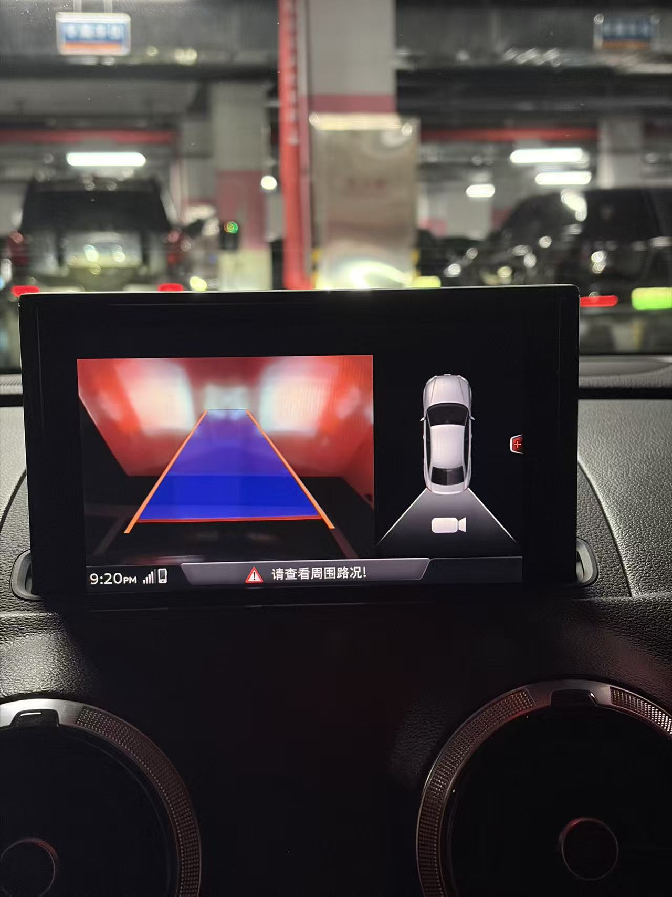
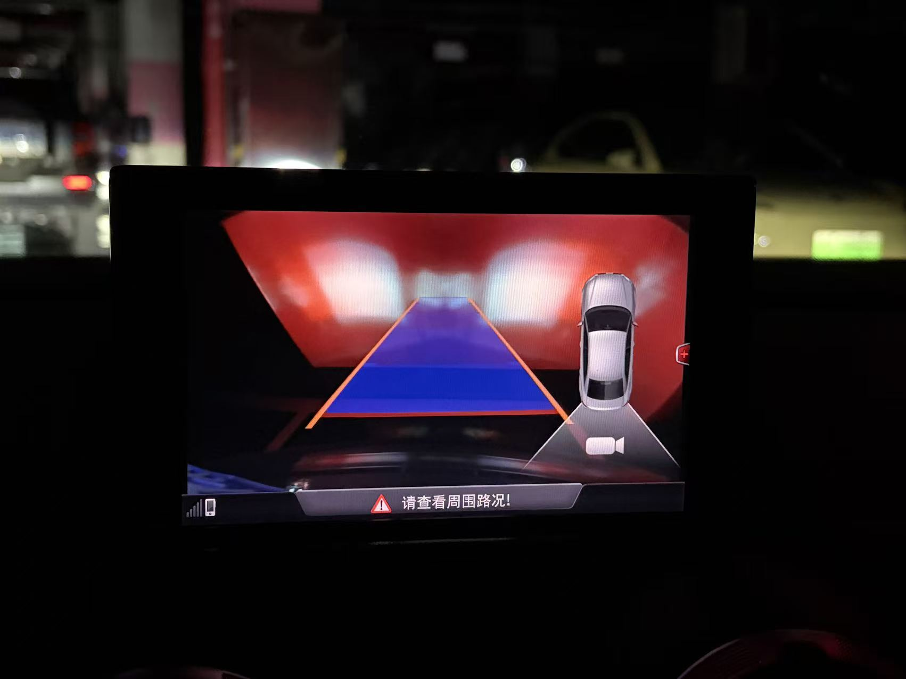

[简体中文](#zh-cn) | [English](#english)

<a id="zh-cn"></a>

# Audi MHI2 (P0916) 全屏倒车影像补丁 · M.I.B. 一键安装包

基于 [mrfixpl/Audi-MHI2-RVC-fullscreen](https://github.com/mrfixpl/Audi-MHI2-RVC-fullscreen) 的 AU37x 方案，针对国行 **MHI2_CN_AU37x_P0916** 固件制作的 **M.I.B. 3.7.3** 自定义脚本安装包。

原厂倒车影像只占屏幕左侧，右侧是一块不透明的驻车雷达背景板。打上补丁后，摄像头画面会铺满整个屏幕，同时保留右侧半透明的车身图层与按键。

> **实车测试情况（v1.2）**
> - 已在国行 `MHI2_CN_AU37x_P0916` 实车验证通过，倒车画面全屏与右侧车身图层显示正常。
> - 注：测试车仅原厂后雷达（无前雷达/无可视 OPS 扇区），因此可视雷达扇区动画尚未在带可视雷达的车上实测。如你的车带有可视雷达，欢迎反馈效果。

---

## 效果对比

| 原厂默认（左侧小画面） | 安装 v1.2 后（全屏画面 + 右侧车身图层） |
| :---: | :---: |
|  |  |

---

## 安装步骤

### 1. 准备工作
- 车机固件版本必须是 **`MHI2_CN_AU37x_P0916`**（脚本内置了版本与文件 SHA-1 校验，其他固件版本会自动拦截退出，不会强刷）。
- 准备一张已经做好 **M.I.B. 3.7.3** 的 SD 卡（本仓库只提供补丁脚本，不包含 M.I.B. 本体）。

### 2. 拷贝补丁到 SD 卡
去 [Releases](../../releases) 下载最新的 `Audi-MHI2-P0916-RVC-MIB-v1.2.zip`（或者直接下载仓库源码），解压后把 `SD_ROOT` 里面的 **`mod` 文件夹**复制到 SD 卡根目录。

复制好后的 SD 卡目录结构如下（注意不要把 `SD_ROOT` 这一层目录本身考进去）：

```text
SD 卡根目录/
├── apps/                         # M.I.B. 原有目录
├── VERSION                       # M.I.B. 原有文件
└── mod/
    ├── custom.sh                 # 补丁入口脚本
    └── rvc_p0916/
        ├── ACTION.txt            # 默认内容为 INSTALL
        ├── manifest.txt          # 20 个资源文件的 SHA-1 清单
        ├── originals/            # P0916 原厂基准文件
        └── patched/              # v1.2 修改后的文件
```

*(如果你卡里原本就有其他用途的 `mod/custom.sh`，请先自己改名备份。)*

### 3. 上车刷入
1. 把 SD 卡插入车机，进入绿菜单：`M.I.B. → Advanced Settings → Run Custom Script`，运行 `/mod/custom.sh`。
2. 屏幕开头会打印 `installer v1.2 radar recovery`。脚本会自动校验车机文件、把修改前的原车文件备份到 SD 卡，然后写入补丁。
3. 看到屏幕出现 **`INSTALL COMPLETE`** 后，手动重启 MMI 即可生效（执行过程中保持通电，不要中途拔卡或断电）。

---

## 状态检查与恢复原厂

如需只做检查或恢复原厂，用文本编辑器打开 SD 卡上的 `mod/rvc_p0916/ACTION.txt`，把第一行改成对应指令，再进绿菜单跑一次 `Run Custom Script` 即可：

| `ACTION.txt` 内容 | 作用 |
| :--- | :--- |
| `INSTALL` | **安装补丁**（默认值）。支持从原厂状态直接安装，也支持从旧版 v1.0 / v1.1 直接覆盖升级。 |
| `CHECK` | **仅做预检**。校验车机版本、SD 卡安装包和车机当前资源哈希，不改动任何文件。 |
| `RESTORE` | **恢复原厂**。把涉及的 20 个文件全部还原回 P0916 原厂状态（看到 `RESTORE COMPLETE` 后重启 MMI）。 |

> **小提示**：绿菜单最外层固定会打印一句 `execution finished`，那只代表脚本跑完了；具体有没有成功，请看脚本自己输出的 `INSTALL COMPLETE`、`RESTORE COMPLETE`、`ALREADY INSTALLED` 或 `ERROR`。

### 自动备份位置
每次实际替换文件前，脚本都会先把车机当时的 20 个文件自动备份到 SD 卡：

```text
SD 卡/backup/RVC_P0916_FULLSCREEN/run-N/
├── before/       # 刷入前从车机提取的原始文件
├── before.txt    # 刷入前各文件的 SHA-1 记录
└── run.log       # 当次执行日志
```

---

## v1.2 到底改了什么？

只动了 UI 资源和显示布局配置，**不碰 IFS、EEPROM、FEC、车辆编码或 CarPlay**。相比 P0916 原厂资源，最终只改了 3 个文件：

| 文件名 | 修改内容 |
| :--- | :--- |
| `displaymanager.json` | 将倒车视频源设为 `720×480`，渲染目标区域放大至 `800×438` |
| `2100002.png` | 右侧主背景替换为透明图层 |
| `2100003.png` | 调整分割线图层 |

其余 17 个文件（`2100137.png`、`2100145.png`～`2100156.png` 以及 4 个 `OPS_AU37*.kzb`）均保持 P0916 原厂基准不动，确保车身、雷达和按钮图层不被破坏。之所以包里依然带着全部 20 个文件，是为了让刷过早期测试版（v1.0 / v1.1）的车友能一键修复，并且随时能用 `RESTORE` 完整还原。

详细版本变更见 [CHANGELOG.md](CHANGELOG.md)，离线测试记录见 [docs/VALIDATION.md](docs/VALIDATION.md)。

---

## 常见问题

- **提示 `Target differs from all known versions`**：说明你车机上的某个文件跟标准 P0916 哈希不一致（可能之前手工改过其他补丁）。脚本为了安全会直接中止，不会改动车机。提 Issue 时贴一下报错文本和对应文件的 SHA-1 即可（注意不要上传含 VIN 或个人信息的整机备份）。
- **提示缺少 `sha1sum`**：脚本依赖 M.I.B. 自带的 `apps/sbin/sha1sum`，请检查 SD 卡上的 M.I.B. 3.7.3 文件是否完整。

### 本地校验与打包（开发者）
需 Python 3.9+（仅用标准库，无第三方依赖）：

```bash
python tools/verify.py         # 校验 manifest、脚本换行符与 43 个文件的哈希
python tools/build_release.py  # 在 dist/ 下生成发布 ZIP 及 SHA-256 校验文件
```

---

## 致谢与声明

- **[mrfixpl / Audi-MHI2-RVC-fullscreen](https://github.com/mrfixpl/Audi-MHI2-RVC-fullscreen)**：原版全屏思路与 AU37x 资源修改方案。
- **[M.I.B. (More Incredible Bash)](https://github.com/Mr-MIBonk/M.I.B._More-Incredible-Bash)**：Custom Script 运行环境。
- **[MIB Helper Wiki](https://wiki.mib-helper.com/index.php?title=Audi_MHI2_RVC_fullscreen_patch)**：原版全屏补丁资料。

本项目遵循上游要求，**仅供个人非商业免费使用**，详见 [NOTICE.md](NOTICE.md)。刷机有风险，操作前请自行保留车机备份。

---

<a id="english"></a>

# Audi MHI2 (P0916) Fullscreen Rear-View Camera · M.I.B. Installer

An automated **M.I.B. 3.7.3** Custom Script installer that enables fullscreen rear-view camera display on **MHI2_CN_AU37x_P0916**, based on the AU37x modification from [mrfixpl/Audi-MHI2-RVC-fullscreen](https://github.com/mrfixpl/Audi-MHI2-RVC-fullscreen).

By default, the stock rear-view camera stream only occupies the left portion of the screen, with an opaque panel on the right. This patch stretches the camera view to fullscreen (`800×438`) while keeping the transparent right-side car overlay and UI controls intact.

> **Vehicle testing status (v1.2)**
> - Tested and confirmed working on a Chinese-market `MHI2_CN_AU37x_P0916` head unit.
> - Note: The test vehicle only has rear acoustic parking sensors (no front sensors / no visual OPS graphic). If your car has visual OPS bars, feedback is welcome.

---

## Before & After

| Stock Layout | With v1.2 Patch |
| :---: | :---: |
|  |  |

---

## Installation

### 1. Prerequisites
- Head-unit firmware must be **`MHI2_CN_AU37x_P0916`** (the script verifies firmware and SHA-1 hashes before touching anything and aborts safely on mismatches).
- A working **M.I.B. 3.7.3** SD card (this repository only contains the patch payload, not M.I.B. itself).

### 2. Copy to SD Card
Download `Audi-MHI2-P0916-RVC-MIB-v1.2.zip` from [Releases](../../releases) (or clone this repo), and copy the **`mod` folder** from `SD_ROOT` into the root of your M.I.B. SD card.

Your SD card root should look like this (do not copy the `SD_ROOT` wrapper folder itself):

```text
SD card root/
├── apps/                         # Existing M.I.B. directory
├── VERSION                       # Existing M.I.B. file
└── mod/
    ├── custom.sh                 # Entry script executed by M.I.B.
    └── rvc_p0916/
        ├── ACTION.txt            # Defaults to INSTALL
        ├── manifest.txt          # SHA-1 manifest for all 20 resources
        ├── originals/            # Stock P0916 baseline files
        └── patched/              # Patched v1.2 files
```

*(If you already have a `mod/custom.sh` on your card for another script, back it up first.)*

### 3. Run on the Head Unit
1. Insert the SD card and open `M.I.B. → Advanced Settings → Run Custom Script` to execute `/mod/custom.sh`.
2. You should see `installer v1.2 radar recovery` at the top. The script verifies all hashes, backs up your current files to the SD card, and applies the patch.
3. Wait for **`INSTALL COMPLETE`**, then manually reboot the MMI. Keep the ignition/power stable during execution.

---

## Check & Restore to Stock

To run a dry-run check or revert to stock, open `mod/rvc_p0916/ACTION.txt` on the SD card, change the first line to one of the commands below, and run `Run Custom Script` again:

| `ACTION.txt` | Description |
| :--- | :--- |
| `INSTALL` | **Install patch** (default). Works on stock P0916 as well as earlier v1.0 / v1.1 states without uninstalling first. |
| `CHECK` | **Dry-run check**. Verifies firmware, package integrity, and current head-unit file hashes without modifying anything. |
| `RESTORE` | **Restore to stock**. Reverts all 20 target files back to the stock P0916 baseline (reboot MMI after `RESTORE COMPLETE`). |

> **Tip**: M.I.B.'s outer menu always prints `execution finished` when a script exits. Check the script's own status line (`INSTALL COMPLETE`, `RESTORE COMPLETE`, `ALREADY INSTALLED`, or `ERROR`) to confirm the actual result.

### Automatic Backups
Before modifying any file, the installer saves and verifies a snapshot of the 20 files currently on your head unit:

```text
SD card/backup/RVC_P0916_FULLSCREEN/run-N/
├── before/       # Files backed up before this run
├── before.txt    # SHA-1 checksums before this run
└── run.log       # Execution log
```

---

## What v1.2 Changes

This patch only touches display layout config and UI graphics—it does **not** touch IFS, EEPROM, FEC, coding, or CarPlay files. Compared to stock P0916, only 3 files are modified:

| File | Modification |
| :--- | :--- |
| `displaymanager.json` | Sets video source to `720×480` and target viewport to `800×438` |
| `2100002.png` | Replaces opaque background with a transparent layer |
| `2100003.png` | Adjusts divider graphic |

The remaining 17 files (`2100137.png`, `2100145.png`–`2100156.png`, and the four `OPS_AU37*.kzb` files) are stock P0916 files included so the installer can cleanly upgrade units that previously ran v1.0 / v1.1 and restore all 20 files whenever `RESTORE` is run.

See [CHANGELOG.md](CHANGELOG.md#english) for version history and [docs/VALIDATION.md](docs/VALIDATION.md#english) for offline test notes.

### Verification & Packaging (Maintainers)
Requires Python 3.9+ (standard library only):

```bash
python tools/verify.py         # Verify manifest, LF line endings, and 43 SD_ROOT files
python tools/build_release.py  # Build release ZIP and SHA-256 checksum in dist/
```

---

## Credits & License

- **[mrfixpl / Audi-MHI2-RVC-fullscreen](https://github.com/mrfixpl/Audi-MHI2-RVC-fullscreen)**: Original fullscreen RVC concept and AU37x modifications.
- **[M.I.B. (More Incredible Bash)](https://github.com/Mr-MIBonk/M.I.B._More-Incredible-Bash)**: Custom Script environment.
- **[MIB Helper Wiki](https://wiki.mib-helper.com/index.php?title=Audi_MHI2_RVC_fullscreen_patch)**: Upstream documentation.

For personal, non-commercial use only—see [NOTICE.md](NOTICE.md#english). Always keep a backup before modifying your head unit.
